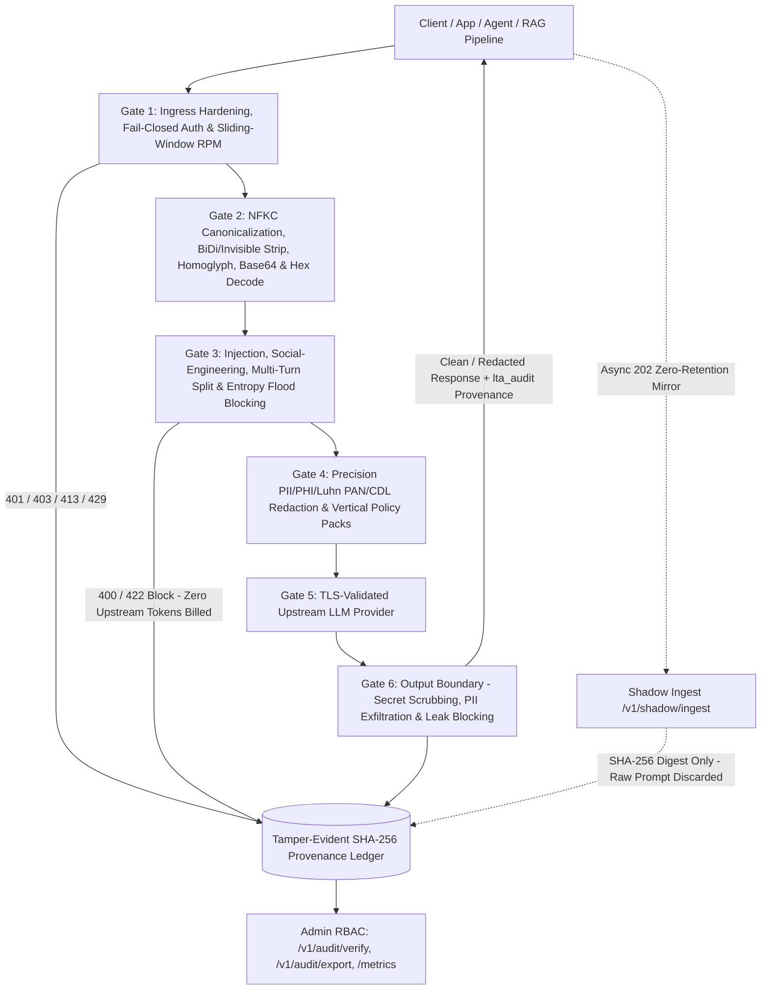
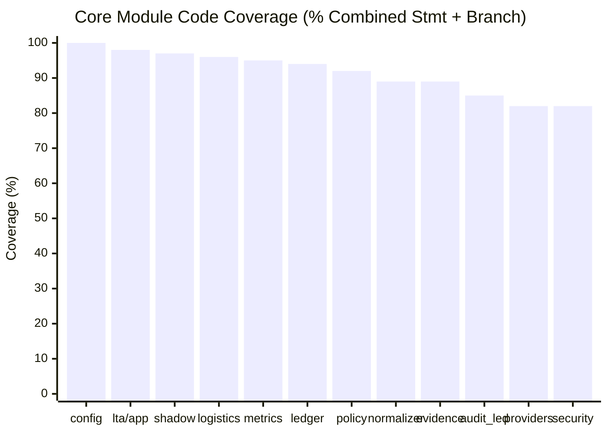
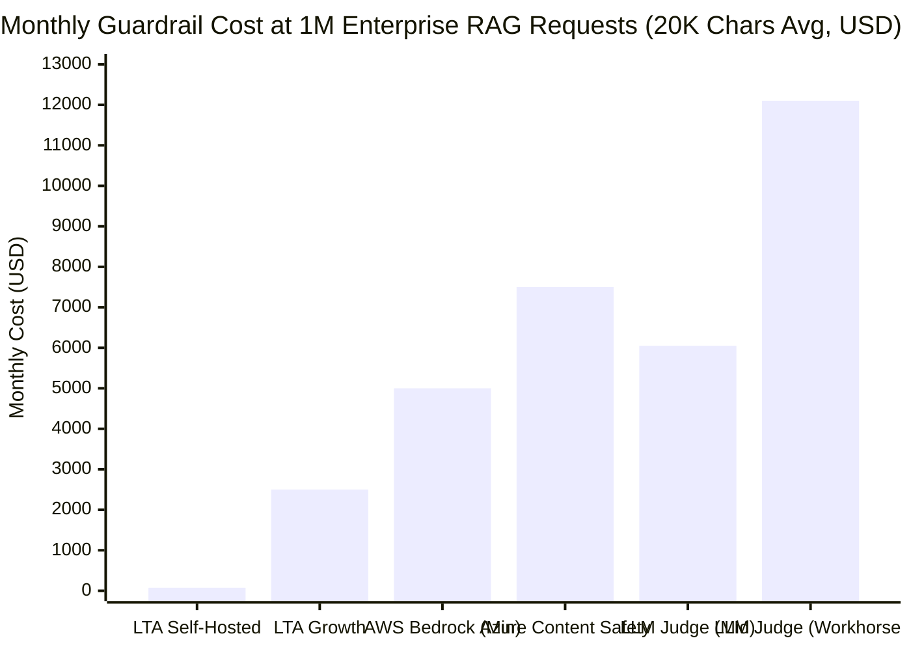

# Lucid-Truth-Audit (`v2.4.0`)


-1E8E3E?style=flat-square)


**Lucid-Truth-Audit (LTA)** is an independent, CPU-native, fail-closed AI security gateway, deterministic guardrail engine, and cryptographically verifiable audit ledger built to govern production Large Language Models (LLMs), retrieval-augmented generation (RAG) pipelines, and autonomous agents across any cloud, virtual private cloud (VPC), or air-gapped environment.

By normalizing, de-obfuscating, inspecting, and schema-validating every prompt, multi-turn conversation history, structured domain payload, and model output *before* upstream token billing or downstream execution occurs, Lucid-Truth-Audit stops Unicode/encoding evasions, halts runaway agent loops, redacts regulated Personally Identifiable Information (PII) and Protected Health Information (PHI), and seals every decision into a **SHA-256 hash-chained provenance ledger** bound to active policy digests, serialized provenance JSON hashes, and runtime configuration fingerprints.

In automated CI validation (`Python 3.11.18`, `pytest 9.2.0`, `pytest-cov 6.3.0`), Lucid-Truth-Audit passes **142 of 142 security, provenance, compliance, and deployment tests in ~6.7 seconds** at **88.73% combined statement-and-branch coverage** (`91.4%` statement coverage across `2,140` statements and `638` branches) alongside a **9-check live production OpenAPI smoke test**. Unlike metered cloud moderation APIs that bill per 1,000 characters or neural LLM-as-a-Judge stacks that double inference spend and require dedicated GPU clusters, Lucid-Truth-Audit executes on commodity CPU with **zero per-character fees, zero per-token markups, and zero GPU overhead**. Across illustrative mid-market and enterprise workloads running late-2026 workhorse or frontier models ($2–$8 input / $10–$40 output per million tokens), pre-LLM token savings, runaway-loop containment, and replacement of metered guardrail APIs yield **5.8-day to 29.5-day direct payback** on managed commercial tiers—before counting an estimated **$48,300/year** in automated audit-evidence labor recovery or exposure reduction against IBM's 2026 **$5.89 million** average prompt-injection breach cost.

> **Engineering Transparency & Scope Notes**
> 1. **Layer 0 Determinism vs. Semantic Classifiers:** Deterministic canonicalization, encoding extraction, strict Pydantic schemas, and vertical policy packs eliminate character-smuggling evasions, role spoofing, token floods, regulated-identifier leaks, and statutory rule violations with **100% run-to-run consistency**. For subtle, unencoded natural-language reframing on high-risk endpoints, pair Lucid-Truth-Audit as Layer 0 in front of an optional semantic classifier.
> 2. **Latency Benchmarking:** Unit guardrail checks complete in `1–6 ms` and end-to-end FastAPI test rounds complete in `5–30 ms` on CI CPUs. Because no independent third-party high-concurrency load benchmark is published yet, production teams should profile `p95`/`p99` latency on target hardware via the built-in Prometheus endpoint (`GET /metrics`).
> 3. **Commercial Schedule:** The pricing tiers and dual-licensing schedule below are calibrated to late-2026 market alternatives as a commercial baseline and are finalized per customer order form or MSA.

---

## Table of Contents

- [System Architecture & Deterministic Security Pipeline](#system-architecture--deterministic-security-pipeline)
- [Cryptographic Provenance & Configuration Fingerprinting (`v2.4.0`)](#cryptographic-provenance--configuration-fingerprinting-v240)
- [API Surface & OpenAPI Endpoint Map](#api-surface--openapi-endpoint-map)
- [Validation Reports, Code Coverage & Live Smoke Tests](#validation-reports-code-coverage--live-smoke-tests)
- [Compliance & Governance Framework Crosswalk](#compliance--governance-framework-crosswalk)
- [Adversarial Resilience & Competitive Market Benchmarks](#adversarial-resilience--competitive-market-benchmarks)
- [Universal Deployment Guide Across Any Setting](#universal-deployment-guide-across-any-setting)
- [Token Economics & Self-Funding ROI Model](#token-economics--self-funding-roi-model)
- [Commercial Pricing Schedule](#commercial-pricing-schedule)
- [Dual Licensing Model & Legal Notices](#dual-licensing-model--legal-notices)
- [References](#references)

---

## System Architecture & Deterministic Security Pipeline

Foundation models process developer instructions, user prompts, conversation turns, and retrieved documents within a single token stream—meaning system prompts are advisory context, not enforceable security boundaries. Placing a second probabilistic LLM in front of the primary model adds multi-second latency, extra token spend, and non-determinism (a 2026 arXiv study found repeated temperature-0 LLM policy checks agreed only **48.7%–71.3%** of the time).

Lucid-Truth-Audit establishes a deterministic runtime control plane *outside* model weights across two modular Python packages—`app/` (core guard service, cryptographic evidence chain, zero-retention shadow API, and domain dispatch schemas) and `lta/` (multi-tenant OpenAI-compatible gateway, declarative policy engine, cryptographic provenance ledger, Prometheus metrics registry, and sliding-window rate limiter).



### Six Sequential Runtime Enforcement Gates

1. **Ingress Hardening, Fail-Closed Auth & Rate Limiting (`lta/app.py`, `lta/config.py`, `lta/rate_limiter.py`, `app/security.py`):** Enforces `LTA_MAX_BODY_BYTES` (`256 KB` default, `413`), security headers (`X-Request-ID`, `Cache-Control: no-store`, `X-Content-Type-Options: nosniff`, `X-Frame-Options: DENY`), hashed API key authentication, expired-trial rejection (`403`), auth-failure brute-force limiting, and fail-closed startup/request rejection when no tenant credentials exist. Strict Pydantic v2 schemas (`extra="forbid"`) reject unexpected fields, non-finite floats (`NaN`/`Inf`), misplaced client `system` roles, and policy-pack downgrade headers (`X-LTA-Policy` / `X-LTA-Provider` restricted to admin RBAC).
2. **Multi-Stage Canonicalization & Decoding (`app/normalizer.py`, `app/core/sanitizer.py`, `lta/policy_engine.py`):** Strips zero-width characters (`\u200b`), soft hyphens (`\xad`), BiDi overrides (`\u202e`), and combining diacritics (`\u0301`); folds Cyrillic/cross-script homoglyphs; normalizes leetspeak and punctuation; and extracts hidden printable payloads inside Base64 and hexadecimal strings (including space-separated hex) prior to policy inspection.
3. **Adversarial Input, Multi-Turn & Flood Blocking (`app/main.py`, `lta/policy_engine.py`):** Screens individual turns and concatenated multi-turn histories against direct/indirect prompt injections, social-engineering PII pretexts, poisoned assistant turns, repeating-character/word loops, and high-entropy gibberish floods (`shannon_entropy`) while preserving benign technical and operational prose.
4. **Precision PII/PHI Redaction & Vertical Policy Packs (`lta/policy_engine.py`, `app/schemas/logistics_guard.py`):** Applies tenant-bound policy packs (`general_enterprise`, `healthcare_hipaa`, `finance_pci`, `fmcsa` / `logistics_fmcsa`). Payment PANs undergo mathematical **Luhn checksum verification** so operational identifiers and purchase orders (e.g., `PO8492014`) are never corrupted, alongside SSN, multistate Commercial Driver's License (CDL), and multi-entity PII masking. Structured freight dispatch payloads validate Hours-of-Service limits, weight/permit rules, authorized waypoint allowlists, and Bill-of-Lading (BOL) indirect-injection traps.
5. **TLS-Enforced Upstream Routing & Output Boundary (`lta/providers.py`, `lta/policy_engine.py`):** `validate_upstream_url` enforces HTTPS on remote endpoints while permitting local hosts for self-hosted inference (vLLM/Ollama). Outbound responses pass through `evaluate_output` and `_scrub_secrets` to block instruction leaks, raw SSNs, and API token exfiltration.
6. **Tamper-Evident Audit Ledger, Evidence Chain & Zero-Retention Shadow Telemetry (`lta/audit_ledger.py`, `app/ledger.py`, `app/evidence_chain.py`, `app/api/shadow.py`, `lta/metrics.py`):** Writes hash-chained records to SQLite or PostgreSQL (`psycopg_pool`). Raw prompts are **never** stored on block or shadow events—only `payload_sha256` digests. CSV exports neutralize formula injection (`sanitize_csv_cell`), SIEM JSONL exports isolate tenants strictly by `tenant_id`, and Prometheus metrics track request counts, policy blocks, and latency quantiles.

---

## Cryptographic Provenance & Configuration Fingerprinting (`v2.4.0`)

Regulatory audits under the EU AI Act (Article 12), SOC 2 Type II, ISO/IEC 42001, and U.S. DOT Order 1351.41 require proving *which exact policy rules and runtime parameters* governed every AI decision—not merely that a log line exists.

In `v2.4.0`, every request passing through `/v1/chat/completions`, `/api/v1/guard`, or `/v1/shadow/ingest` computes four deterministic SHA-256 bindings inside `lta/audit_ledger.py`:

| Cryptographic Field | Generator Function | Bound Inputs | Audit Guarantee |
| :--- | :--- | :--- | :--- |
| **`policy_sha256`** | `compute_policy_digest()` | Canonical sorted JSON of active `PolicyPack` rules, version, and metadata (ignoring ephemeral `_private` / cache fields) | Any silent rule edit—even without bumping `policy_version`—alters the digest immediately. |
| **`config_fingerprint`** | `compute_config_fingerprint()` | `gateway_version`, `policy_name`, `policy_version`, `policy_sha256`, `provider`, `max_body_bytes`, `rate_limit_rpm`, `auth_fail_limit_rpm`, security flags | Deduplicated into `policy_snapshots`; proves exact gateway posture at decision time. |
| **`provenance_hash`** | `compute_provenance_hash()` | `prev_hash`, `payload_sha256`, `policy_name`, `policy_version`, `policy_sha256`, `config_fingerprint`, `request_id` | Cryptographically welds payload digest, runtime posture, and ledger chain position together. |
| **`provenance_json_sha256`** | `AuditLedger.record()` | Exact UTF-8 bytes of serialized `provenance_json` | Directly detects any post-hoc modification to `provenance_json` during `verify_chain()`. |
| **`entry_hash`** | `_compute_entry_hash()` | All row fields + `prev_hash` + `provenance_hash` + `provenance_json_sha256` (genesis anchored at `"0" * 64`) | Altering a single field (`action`, `policy_version`, `http_status`, `provenance_json`, or digest) breaks `GET /v1/audit/verify` and pinpoints `first_broken_seq_id`. |

---

## API Surface & OpenAPI Endpoint Map

All 9 live OpenAPI routes verified against `https://lucid-truth-audit.onrender.com/openapi.json`:

| Method & Path | Auth Scope | Purpose & Response Contract |
| :--- | :--- | :--- |
| `POST /v1/chat/completions` | Tenant API Key (`X-API-Key` or `Bearer`) | Drop-in OpenAI-compatible proxy returning standard completion choices + `lta_audit` (`action`, `policy_pack`, `policy_version`, `policy_sha256`, `config_fingerprint`, `provenance_hash`, `redactions`, `latency_ms`, `entry_hash`). |
| `POST /api/v1/guard` | Tenant API Key | Synchronous pre-LLM/standalone guard (`{"model_input": "...", "metadata": {...}}`) returning `sanitized_output`, `redactions`, and full `lta_audit` provenance metadata. |
| `POST /v1/shadow/ingest` | Shadow Key (`LTA_SHADOW_KEY`) or Tenant Key | Asynchronous zero-retention telemetry (`202 Accepted`) returning `"status": "accepted"`, `"zero_retention": true`, `audit_id`, `audit_entry_hash`, `input_sha256`, `would_allow`, `vector`, `redactions`, and provenance digests. |
| `GET /v1/audit/verify` | Admin RBAC | Recomputes the entire SHA-256 audit chain + SQLite/PostgreSQL linkage, returning `chain_valid`, `total_entries`, and `first_broken_seq_id`. |
| `GET /v1/audit/export` | Admin RBAC | Streams tenant-filtered NDJSON (`application/x-ndjson`) with full provenance fields for SIEM ingestion (Splunk, Datadog, Sentinel, Chronicle). |
| `GET /v1/policies` | Tenant / Admin | Enumerates loaded declarative `PolicyPack` configurations bound to the gateway. |
| `GET /metrics` | Admin RBAC | Prometheus exposition metrics (`text/plain`) for request volumes, policy blocks by vector, and latency quantiles. |
| `GET /healthz` | Public Probe | Lightweight liveness probe reporting service name, `version` (`2.4.0`), and `policies_loaded`. |
| `GET /readyz` | Public Probe | Deep readiness probe executing `AuditLedger.ping()` (`200 OK` when ledger and policies are healthy; `503` fail-closed otherwise). |

---

## Validation Reports, Code Coverage & Live Smoke Tests

### Latest CI Validation Summary (November 27, 2026)

* **Environment:** `Python 3.11.18`, `pytest 9.2.0`, `pytest-cov 6.3.0`, `pytest-html 4.2.0`, `pytest-json-report 1.5.0` on `Linux x86_64`
* **Offline Security, Provenance & Compliance Suite:** **142 / 142 tests passing** (`~6.7s` total runtime)
* **Code Coverage:** **88.73% combined statement + branch coverage** (`91.4%` statement coverage across `2,140` statements and `638` branches; exceeds `60%` CI gate by `+28.73%`)
* **Archived CI Validation Artifact:** `lucid-truth-audit-3.11-validation.zip` (`26` files including `reports/compliance_audit.html`, `reports/audit_ledger.json`, and `reports/coverage/`)



### Automated Test Suite Breakdown (142 Tests Across 22 Modules)

| Test Suite | Tests | Verified Security, Provenance & Compliance Invariants |
| :--- | :---: | :--- |
| `tests/test_production_suite.py` | 20 | Unauthenticated `422` rejected `401` without ledger write; authenticated `422` logged under real tenant; expired trial key `403`; hardened obfuscation (Base64, `\xad`, `\u0301`, leetspeak, synonym override, `SYSTEM:` override, space-separated hex); obfuscated BOL injections; multistate CDL redaction preserving `PO8492014`; 60/7 & 70/8 HOS cycle overflow + permits; multi-turn PII + flood blocking; CSV formula-injection escaping |
| `test_audit.py` | 19 | Framework version parity; benign/educational allowlisting; plain, `\u200b` zero-width, Cyrillic homoglyph, Base64, and hex injection blocking; missing/invalid key rejection; fail-closed missing server secret; strict schema validation; zero raw-prompt logging on block events; SSN redaction; health version probe |
| `tests/test_enterprise_gateway.py` | 19 | Admin RBAC on `/v1/audit/*` and `/metrics`; hash-chain tamper detection & SIEM export; anti-policy-downgrade & anti-poisoned-assistant-turn checks; fail-closed zero-tenant config; `finance_pci`, `healthcare_hipaa`, and `logistics_fmcsa` policy packs; flood & system-role spoofing blocks; body-size cap (`413`); `NaN` metadata rejection; OpenAI proxy & `/api/v1/guard` parity; output boundary leak blocks; tenant-isolated rate limiting; split multi-turn injections; upstream TLS validation |
| `tests/test_vector4_logistics.py` | 11 | FMCSA-compliant dispatch clearance; 5 parameterized HOS & weight violation blocks; 3 indirect BOL prompt injections (weigh-station bypass, GPS coordinate hijack, 15-hour run override); unauthorized waypoint hijack blocking; driver & manifest PII redaction |
| `test_vector2_pii.py` | 8 | Social-engineering PII pretext blocking (impersonated sysadmin, security auditor, compliance officer); Luhn-validated PAN masking preserving benign IDs; multi-entity PII redaction; output validator blocking raw SSN & API secret exfiltration; strict Pydantic schema clearance |
| `test_vector3_resilience.py` | 8 | Sliding-window `429` enforcement; per-key isolation; repeating-character flood, repeating-word flood, and high-entropy gibberish blocking; benign prose clearance; multi-turn system-role spoofing & schema rejection |
| `test_audit_ledger_and_providers.py` | 5 | Ledger chain verification & tamper detection; tenant-filtered JSONL export (`limit` support); connection-error `ping()` returning `False`; upstream HTTPS & local-host validation; secret scrubbing |
| `tests/tests/test_provenance_unit.py` | 5 | `compute_policy_digest` key-order determinism, rule-mutation sensitivity, object/private-field exclusion & `None` fallback; `compute_config_fingerprint` runtime setting sensitivity; `compute_provenance_hash` chain/payload/config binding; end-to-end provenance verification |
| `tests/tests/test_lta_app_remaining_lines.py` | 5 | Client IP resolution, JSONL formatting, hash extraction, SQLite chain inspection, `verify_chain` unpacking, `LTA_DISABLE_DOCS` flag, auth rate-limit headers, output guard, and Prometheus metrics |
| `tests/tests/tests/test_lta_providers_and_app_coverage.py` | 5 | Upstream HTTPS/local validation, simulated fallback & secret-leak triggers, transient `503` retries with secret scrubbing, Gemini/Anthropic adapters, and gateway audit chain |
| `tests/test_app_main_unit.py` | 4 | Key fallback, CORS, CSP & validation handlers, Luhn redaction & flood validators, guard turn blocks & CSV export |
| `tests/test_deployment_validation.py` | 4 | `Dockerfile` entrypoint & healthcheck; Render persistent storage & healthcheck; `docker-compose.yml` service definitions; CI validation gate completeness |
| `tests/test_evidence_chain.py` | 4 | Cryptographic evidence creation & verification; strict cross-tenant isolation; persistence across store recreation; tamper detection |
| `tests/test_lta_app_snippet_coverage.py` | 4 | Unconfigured tenants & auth rate-limit enforcement, non-admin policy override blocks, invalid `Content-Length` handling, and lifespan ledger-close resilience |
| `tests/tests/test_lta_app_edge_branches.py` | 4 | Non-finite float metadata rejection, header extractors & short-hash padding, SQLite path/chain edge cases, and shadow env-key auth fallbacks |
| `tests/test_audit_ledger_unit.py` | 3 | SQLite record/verify/`provenance_json` tamper/export/close lifecycle; transactional rollback on DB error; PostgreSQL `psycopg_pool` connection & fallback verification |
| `tests/test_providers_unit.py` | 3 | Secret scrubbing & URL validation; mock simulation & fallback variants; HTTP JSON transport & provider adapters |
| `tests/test_shadow_ingest.py` | 3 | Missing auth `401` rejection; invalid key `403` rejection; `202 Accepted` zero-retention audit logging |
| `tests/tests/test_lta_app_95_to_100.py` | 3 | Finite metadata & unknown policy pack rejection, `/readyz` `503` on unhealthy ledger, and shadow eval/record fallbacks |
| `tests/test_rate_limiter_unit.py` | 2 | Sliding-window blocking & tenant isolation; time-window rollover & reset |
| `tests/tests/test_lta_config_coverage.py` | 2 | Single-key `Settings.from_env` mode and empty-key/empty-tenant authentication rejection |
| `tests/tests/test_gateway_provenance_e2e.py` | 1 | Full gateway E2E verifying `/v1/chat/completions`, `/v1/shadow/ingest`, `/v1/audit/verify`, `/v1/audit/export`, and SQLite `policy_version` tampering detection |

### Module-by-Module Code & Branch Coverage Ledger

| Source Module | Stmts | Miss | Branches | BrPart | Total Cover |
| :--- | :---: | :---: | :---: | :---: | :---: |
| `lta/__init__.py` | 1 | 0 | 0 | 0 | **100%** |
| `lta/config.py` | 50 | 0 | 12 | 0 | **100%** |
| `lta/app.py` | 441 | 3 | 124 | 9 | **98%** |
| `app/api/shadow.py` | 79 | 2 | 8 | 1 | **97%** |
| `app/schemas/logistics_guard.py` | 88 | 2 | 18 | 2 | **96%** |
| `lta/metrics.py` | 36 | 1 | 8 | 1 | **95%** |
| `app/ledger.py` | 73 | 2 | 8 | 3 | **94%** |
| `lta/policy_engine.py` | 263 | 14 | 114 | 15 | **92%** |
| `app/evidence_chain.py` | 71 | 7 | 8 | 2 | **89%** |
| `app/normalizer.py` | 68 | 5 | 28 | 6 | **89%** |
| `lta/audit_ledger.py` | 309 | 39 | 88 | 19 | **85%** |
| `app/security.py` | 91 | 15 | 32 | 5 | **82%** |
| `lta/providers.py` | 151 | 21 | 66 | 13 | **82%** |
| `app/main.py` | 280 | 45 | 70 | 2 | **81%** |
| `app/core/sanitizer.py` | 95 | 17 | 44 | 11 | **76%** |
| `lta/rate_limiter.py` | 44 | 11 | 10 | 2 | **72%** |
| **Repository Total** | **2,140** | **184** | **638** | **91** | **88.73%** |

### Live Production Smoke Test Matrix (`scripts/run_smoketest.py`)

Automated post-deployment verification queries the live OpenAPI schema and executes **9 live checks**, outputting an executive-ready HTML compliance report (`lta_smoketest_report.html`) with latency charts and cryptographic hash references:

| # | Live Production Check | Endpoint | Verified Assertion |
| :-: | :--- | :--- | :--- |
| 1 | Health / Liveness | `GET /healthz` | `200 OK` |
| 2 | Readiness & Ledger Ping | `GET /readyz` | `200 OK`, ledger reachable |
| 3 | Missing API Key Rejection | `POST /api/v1/guard` | `401` / `403` fail-closed |
| 4 | Shadow Route Auth Guard | `POST /v1/shadow/ingest` | `401` / `403` auth-guarded |
| 5 | Clean Operational Prompt | `POST /api/v1/guard` | `200 OK` + provenance hash |
| 6 | PII & Secret Redaction | `POST /api/v1/guard` | `200 OK`; raw SSN (`123-45-6789`) & `sk-...` secret absent from response |
| 7 | BiDi + Homoglyph Injection Handling | `POST /api/v1/guard` | `\u202e` override stripped/blocked |
| 8 | Cryptographic Chain Verification | `GET /v1/audit/verify` | `200 OK` intact SHA-256 chain |
| 9 | Zero-Retention Shadow Ingest (BiDi + Homoglyph) | `POST /v1/shadow/ingest` | `202 Accepted`, `"status": "accepted"`, 64-char `input_sha256`, non-null `audit_id` & `audit_entry_hash`, raw SSN absent |

---

## Compliance & Governance Framework Crosswalk

Lucid-Truth-Audit operates as the **runtime technical enforcement and automated evidence plane** that converts written AI governance policies into verifiable request-path controls and auditor-ready logs.

### OWASP Top 10 for LLM Applications (2026 vs. 2025) & Agentic AI Top 10 (ASI)

Aligned to the **OWASP Top 10 for LLM Applications (2026 Edition, August 4, 2026)**, the **OWASP Top 10 for Agentic Applications (2026, ASI01–ASI10)**, and **MITRE ATLAS**:

| OWASP 2026 | 2025 ID | Risk Category | MITRE ATLAS / ASI | Lucid-Truth-Audit Runtime Enforcement & Scope |
| :--- | :--- | :--- | :--- | :--- |
| **LLM01:2026** | LLM01 | Prompt Injection (Direct & Indirect) | `AML.T0051.000/.001/.002`; `ASI01` | **Primary Layer 0 Control:** NFKC canonicalization, invisible/BiDi/diacritic stripping, Cyrillic homoglyph folding, leetspeak normalization, Base64/Hex decoding, multi-turn split-injection blocking, and document/BOL indirect injection screening. *(Pair with a semantic classifier for subtle natural-language reframing.)* |
| **LLM02:2026** | LLM02 | Sensitive Information Disclosure | ATLAS Exfiltration | **Primary Control:** Pre-LLM SSN, Luhn-validated PAN, multistate CDL, and multi-entity PII/PHI redaction; social-engineering pretext blocking; outbound SSN/secret blocking; zero raw-prompt storage on block/shadow events. |
| **LLM03:2026** | LLM06 | Excessive Agency | `ASI02` Tool Misuse; `ASI03` Identity Abuse | **Primary Schema & Boundary Control:** Strict Pydantic `extra="forbid"`, authorized waypoint/facility allowlists, non-downgradeable tenant policy packs, and admin RBAC isolation. *(Pair with least-privilege downstream IAM.)* |
| **LLM04:2026** | LLM03 | Supply Chain | ATLAS Initial Access; `ASI04` | **Supporting Control:** Upstream HTTPS/localhost URL validation blocking unauthorized external redirection plus CI deployment validation. *(Pair with SBOM & model scanning.)* |
| **LLM05:2026** | LLM04 | Data & Model Poisoning | `ASI06` Memory & Context Poisoning | **Runtime Mitigation:** Blocks poisoned assistant turns, client-injected `system` roles, and non-finite `NaN`/`Inf` metadata anomalies prior to inference. |
| **LLM06:2026** | LLM10 | Unbounded Consumption | `ASI08` Cascading Failures; Denial-of-Wallet | **Primary Control:** `256 KB` body-size caps (`413`), repeating-character/word flood blocking, `shannon_entropy` gibberish rejection, and tenant-isolated sliding-window rate limits (`429`). |
| **LLM07:2026** | LLM09 | Misinformation | Domain-Rule Grounding | **Domain-Constraint Control:** Enforces deterministic statutory invariants on structured payloads (e.g., FMCSA HOS and FHWA weight/permit rules). |
| **LLM08:2026** | LLM07 | Hidden Context Exposure | ATLAS Discovery / Exfiltration | **Primary Control:** Blocks system-prompt extraction overrides at ingress and rejects instruction leakage at the output boundary. |
| **LLM09:2026** | LLM08 | Vector & Embedding Weaknesses | ATLAS Persistence / Exfiltration | **Supporting Control:** Screens retrieved RAG chunks and embedded document notes via `/api/v1/guard` or `/v1/chat/completions` before model synthesis. |
| **LLM10:2026** | LLM05 | Improper Output Handling | `ASI05` Unexpected Code Execution | **Primary Control:** Strict Pydantic output validation, API secret scrubbing (`_scrub_secrets`), raw PII exfiltration rejection, and CSV formula-injection escaping (`sanitize_csv_cell`). |

### Global, Sector & U.S. State Regulatory Alignment Matrix

| Framework / Statute | Status (Nov 2026) | Statutory Penalty / Financial Exposure | Lucid-Truth-Audit Technical Controls & Evidence |
| :--- | :--- | :--- | :--- |
| **EU AI Act** — Reg. (EU) 2024/1689 as amended by Digital Omnibus Reg. (EU) 2026/1744 | Art. 5 Bans, GPAI, Art. 50 Transparency & Art. 101 fines **Active**; Art. 50(2) Marking Dec 2, 2026; Annex III High-Risk deferred to Dec 2, 2027; Annex I to Aug 2, 2028 | **Art. 99:** Up to **€35M / 7%** global turnover (Art. 5), **€15M / 3%** (High-Risk/Transparency), **€7.5M / 1%** (misleading info) — lower-of cap for SMEs/SMCs; **Art. 75c** daily periodic penalties up to 5% avg daily turnover | **Art. 12 Record-Keeping:** Hash-chained provenance logs supporting ≥6-month retention (`lta/audit_ledger.py`); **Art. 14 Human Oversight:** Fail-closed policy gates; **Art. 15 Cybersecurity:** Deterministic anti-injection & flood resilience |
| **NIST AI RMF 1.0 & AI 600-1** (+ SP 800-53 Rev 5 / CSF 2.0) | Active U.S. voluntary framework; affirmative defense under Texas TRAIGA | Enterprise procurement, cyber-insurance, and statutory safe-harbor weight | **GOVERN:** Versioned `PolicyPack` SHA-256 digests & RBAC; **MAP:** Zero-retention shadow discovery; **MEASURE:** Prometheus quantiles & 142-test CI reports; **MANAGE:** Inline blocking + SP 800-53 `AU-2/3/8/9/10/11/12` tamper-evident logs |
| **ISO/IEC 42001:2023** (AIMS) & ISO/IEC 42006:2025 | Certifiable international AIMS standard (3-year cycle + annual surveillance) | Industry estimators put Yr 1 costs at **$11.5K–$42K** direct (up to **$85K–$150K** all-in w/ 310–860 internal hrs) | Automated operational evidence for Clauses 6, 8, 9 & Annex A: continuous metrics (`/metrics`), immutable provenance logs, and CI release artifacts |
| **SOC 2 Type II** (AICPA Trust Services Criteria) | Continuous 3–12 month audit window | Industry guides estimate **$25K–$200K+** Yr 1 total cost and 15–20 hrs/mo manual evidence effort | Automated evidence for **CC6.1–CC6.3** (hashed keys, RBAC), **CC6.6** (boundary firewall + TLS), **CC7.2** (flood detection + Prometheus telemetry), and **CC4.1/CC8.1** (142-test CI validation) |
| **HIPAA / HITECH** (45 CFR Parts 160 & 164) | Active federal rule; 2025 inflation tiers (91 FR 3665) frozen through 2026 per Oct 2026 HHS/OMB notice | **$145–$73,011** per violation up to **$2,190,294** annual statutory cap; criminal fines up to $250K / 10 yrs; IBM 2026 avg Healthcare breach **$6.64M** | `healthcare_hipaa` policy pack; pre-LLM PHI/SSN redaction; outbound exfiltration blocking; zero raw-prompt retention in logs; tenant-isolated ledger |
| **PCI DSS v4.0.1** | Sole active version; all previously future-dated requirements mandatory since March 31, 2025 | Reported acquirer non-compliance fees of **$5,000–$100,000/month**, **$50–$90** per compromised record, and $20K–$100K+ forensic audits | `finance_pci` policy pack; **Req. 3:** Luhn-validated PAN masking keeping cardholder data out of prompts/logs; **Req. 4:** TLS upstream enforcement; **Req. 10:** Tamper-evident audit logs |
| **GLBA Safeguards Rule** (16 CFR Part 314) | Active federal rule; 30-day FTC breach notice (500+ records) active since May 2024 | Up to **$53,088 per violation per day** (`16 CFR § 1.98`) + typical 20-year FTC consent orders; IBM 2026 avg Financial breach **$6.29M** | Supports **§314.4(c)** technical safeguards (access control, secret/PII scrubbing, TLS) and **§314.4(d)** continuous runtime monitoring with verifiable logs |
| **FMCSA (49 CFR 395 & 386), FHWA (23 CFR 658), U.S. DOT Order 1351.41 & NMFTA AI Framework** | Federal HOS/weight active; **NMFTA 50-Control AI Framework** released June 26, 2026; **U.S. DOT Order 1351.41** (internal DOT AI policy) effective Aug 26, 2026 | FMCSA caps: **$19,246** carrier non-recordkeeping, **$23,647** permitting OOS, **$15,846** knowing falsification, **$1,584/day** recordkeeping, **$102K–$238K** hazmat; state weight fines **$1K–$10K+**; IBM 2026 Transportation breach **$4.50M** | `fmcsa` / `logistics_fmcsa` pack + `DispatchRoutePayload`: enforces 11-hr driving, 14-hr window, 60/7 & 70/8 cycles, 80,000-lb Interstate gross / Federal Bridge Formula (`W = 500 × [LN/(N-1) + 12N + 36]`) & permit rules, authorized facility allowlists, BOL indirect-injection blocking, and multistate CDL redaction |
| **U.S. State AI Laws** (TX, CO, CA, IL, UT, NYC) | **Active Jan 1, 2026:** TX TRAIGA (HB 149), CA SB 53/AB 2013/CCPA ADMT phase-in, IL HB 3773. **Effective Jan 1, 2027:** CO SB 26-189 & CA ADMT notice/opt-out | TX TRAIGA penalties: **$10K–$12K** curable, **$80K–$200K** uncurable, **$2K–$40K/day** continuing; CA SB 53 up to **$1M/violation** | Tenant-scoped immutable provenance logs, NIST AI RMF control alignment (supporting TX TRAIGA affirmative defense), and structured decision provenance supporting CO SB 26-189 |

> *Jurisdiction Note:* Interstate commercial weight limits (`23 CFR Part 658` / `23 U.S.C. § 127`) are governed by FHWA and enforced by state authorities rather than FMCSA, and U.S. DOT Order 1351.41 governs internal DOT systems while establishing federal transportation governance norms. LTA consolidates HOS (`49 CFR § 395.3`) and interstate weight/permit rules (`23 CFR § 658.17`) into one deterministic pre-dispatch gate.

---

## Adversarial Resilience & Competitive Market Benchmarks

Independent 2025–2026 academic evaluations reveal sharp gaps between vendor marketing accuracy and real-world adversarial bypass rates on neural-only guardrails:

* **Character & Unicode Smuggling (`arXiv:2504.11168`, Hackett et al.):** Testing six widely deployed classifiers against zero-width characters, homoglyphs, diacritics, and Unicode tag/emoji smuggling recorded bypass Attack Success Rates (ASR) of **72.54%** against NVIDIA NeMo Guard Jailbreak Detect, **70.44%–73.08%** against Meta Prompt Guard, **87.95%–91.67%** against Vijil, and **100% ASR** via emoji/Unicode tag smuggling.
* **Transferable Multi-Guardrail Evasion (`BRANCH`, `arXiv:2610.10742`):** Achieved **100% ASR** across 120 scenarios and transferred bypasses across 29 unseen production guardrails (including 8 commercial black-box APIs), lifting average ASR by **+32.9 percentage points**.
* **Cloud Classifiers & LLM-as-a-Judge Stress Tests:** General Analysis's GA Jailbreak Bench recorded adversarial F1 of **0.193** (Azure AI Content Safety), **0.607** (AWS Bedrock Guardrails Prompt Attack), and **0.796** (Meta Llama Guard 4 at ~459 ms avg latency). Optimization attacks on LLM-as-a-Judge (`arXiv:2604.17125`) reached **84.2% ASR**, while prompt-only frontier agents without external runtime enforcement (`arXiv:2609.38224`) suffered an **89.8% (53/59)** bypass rate.

Lucid-Truth-Audit eliminates this encoding gap deterministically at **Layer 0** before any classifier or LLM token executes—stripping BiDi/zero-width/diacritic characters, folding homoglyphs, and decoding Base64/Hex payloads with **100% deterministic repeatability** on CPU.



### Late-2026 Competitive Landscape & M&A Consolidation Benchmark

Between July 2025 and November 2026, acquisitions absorbed major standalone AI security startups (Lakera → Check Point, CalypsoAI → F5, Portkey → Palo Alto Networks, Guardrails AI → Harvey) while LLM Guard was archived—creating lock-in and quote-only pricing across the market:

| Platform | Ownership & Status (Nov 2026) | License & Deployment | Encoding & Obfuscation Defense | Pricing Model (Checked Oct–Nov 2026) | Cryptographic Provenance & Vertical Packs |
| :--- | :--- | :--- | :--- | :--- | :--- |
| **Lucid-Truth-Audit (`v2.4.0`)** | **Independent, active** (`142/142` CI verified Nov 27, 2026) | **Apache 2.0 Open Core + Commercial**; CPU-only Docker/VPC/Air-gapped | **Native:** NFKC, BiDi/invisible/diacritic strip, Cyrillic homoglyphs, leetspeak, Base64 & hex decode | **$0 OSS**; **$1,500 Pilot**, **$2,500/mo Growth (1M reqs)**, **$6,500/mo Enterprise (5M+)** — *zero char/token fees* | **Yes:** SHA-256 hash-chained provenance + policy/config fingerprints; HIPAA, PCI 4.0.1, FMCSA/FHWA packs |
| **AWS Bedrock Guardrails** | Amazon Web Services | Proprietary; AWS Regions | Prompt Attack filter + manual Unicode guidance | **$0.15/1K units** (content/topics) + **$0.10/1K** (PII/grounding) + **$0.17/1K** (Automated Reasoning); 1 unit = 1K chars | CloudWatch logs; generic taxonomies, no hash-chained ledger or FMCSA schemas |
| **Azure AI Content Safety / Prompt Shields** | Microsoft (Preview containers & groundedness retiring Apr 30, 2027) | Proprietary; Azure Cloud | Prompt Shields (10K-char cap; doc attack detection off by default in Foundry) | Free 5K/mo; **$0.375/1K text records** (1K chars) or **$338/mo per 1M commitment** | Azure Monitor logs; no cryptographic ledger or vertical dispatch schemas |
| **Google Cloud Model Armor** | Google Cloud | Proprietary; GCP Regions | Per-turn evaluation; Nov 2026 technical reviews note it does not decode Base64/encodings | Managed per-request pricing; GCP-bound | Google SecOps log ingestion; generic DLP |
| **Check Point AI Guardrails (Lakera)** | Acquired by Check Point (Oct 2025) | Closed SaaS; self-host Enterprise only | ML classifier (100+ languages) | Free 10K/mo; **Enterprise quote-only** (~$74K/yr for 10M reqs on AWS Marketplace) | SaaS logs; no native FMCSA/HIPAA Pydantic action gates |
| **F5 AI Guardrails (CalypsoAI)** | Acquired by F5 (Sept 2025) | Closed SaaS / On-prem / Air-gapped | Adaptive red-team scanners | **Enterprise quote-only** (no public pricing) | Integrated into F5 ADSP dashboards |
| **Prisma AIRS AI Gateway (Portkey + LLM Guard)** | Portkey acquired by Palo Alto Networks (May 2026); LLM Guard archived (July 2026) | Partial OSS gateway / Closed Enterprise | Relies on external/archived scanners | Pro **$49/mo (100K logs) + $9/100K**; Enterprise **$2K–$10K+/mo** (est.) | Logs metered by tier; SSO/VPC gated to Enterprise |
| **NVIDIA NeMo Guardrails** | Active OSS (`v0.24.1`) | Apache 2.0 (opt-out telemetry ping by default) | Colang DSL + GPU NIMs (`+410–690 ms p95` across 1–3 NIMs; 72.54% char-injection ASR in Hackett et al.) | Free OSS; production NIMs require **NVIDIA AI Enterprise ($4,500/GPU/yr)** + GPU compute | Dialog/tool rails; no built-in cryptographic audit ledger |
| **Guardrails AI** | Acquired by Harvey (Sept 2026); hosted Hub shut down Aug 2026 | Apache 2.0 Python library | Community PyPI validators (50–283 ms/validator) | Free OSS (hosted inference discontinued) | Strong Pydantic output repair; no multi-tenant gateway RBAC or hash-chained ledger |
| **Meta Llama Guard 4 / LlamaFirewall** | Llama Guard 4 (Apr 2025); LlamaFirewall (May 2025) | Llama 4 Community License (EU multimodal restriction) / MIT | Neural classifier (~459 ms avg; 70–73% char-injection ASR on Prompt Guard) | Free weights; dedicated GPU hosting **$1,358–$5,022+/mo/GPU** on AWS | Classifier verdict only; requires external gateway, RBAC & ledger |
| **Bifrost / LiteLLM** | Active OSS AI Gateways (Go / Python) | Apache 2.0 / MIT + Enterprise | Delegates safety to Regex/CEL or external paid APIs | Free OSS + VM hosting; Enterprise by quote | Routing & virtual keys; no native FMCSA/HIPAA schemas |

---

## Universal Deployment Guide Across Any Setting

### Five Integration Topologies

| Topology | Integration Pattern | User-Path Latency | Best Operational Fit |
| :--- | :--- | :---: | :--- |
| **1. Drop-In Reverse Proxy** | Point any OpenAI SDK `base_url` at `POST /v1/chat/completions` | Minimal CPU inline | Zero-rewrite security for existing apps, copilots & agent frameworks |
| **2. Pre-Call Guardrail Microservice** | Call `POST /api/v1/guard` prior to Bedrock, Vertex, or custom RAG synthesis | Minimal CPU inline | Multi-cloud pipelines, RAG chunk sanitization & multi-turn inspection |
| **3. Zero-Retention Shadow Mode** | Fire-and-forget async `POST /v1/shadow/ingest` (`202 Accepted`, zero raw storage) | **0 ms** on user path | 30-day pilots, Shadow AI discovery & policy tuning before inline blocking |
| **4. Structured Action & Tool Gate** | Validate agent tool payloads (`DispatchRoutePayload` / custom Pydantic schemas) | Minimal CPU inline | Autonomous agents executing dispatches, EHR updates, payments, or DB writes |
| **5. Sovereign / Air-Gapped Container** | Deploy `Dockerfile` + `docker-compose.yml` beside local vLLM / Ollama | Local LAN only | Defense, government, healthcare & financial VPCs prohibiting outbound telemetry |

### Quickstart: Deploy, Route & Verify

#### 1. Start the CPU-Only Container Stack

```bash
git clone [https://github.com/stickneycorey1-source/Lucid-Truth-Audit-.git](https://github.com/stickneycorey1-source/Lucid-Truth-Audit-.git)
cd Lucid-Truth-Audit-

cp .env.example .env
# Set LTA_TENANTS_JSON, LTA_SHADOW_KEY, LTA_AUDIT_DB_URL, and LTA_DEFAULT_PROVIDER

docker compose up -d --build

# Verify liveness, version (v2.4.0), and persistent ledger connectivity
curl -s http://localhost:8000/healthz
curl -s http://localhost:8000/readyz
```

#### 2. Drop-In OpenAI-Compatible Proxy (`POST /v1/chat/completions`)

```python
from openai import OpenAI

client = OpenAI(
    base_url="[https://lucid-truth-audit.onrender.com/v1](https://lucid-truth-audit.onrender.com/v1)",
    api_key="lta_tenant_live_key_here",  # Verified locally via hashed lookup; never forwarded upstream
)

response = client.chat.completions.create(
    model="gpt-4o-mini",
    messages=[
        {"role": "user", "content": "Summarize Order PO8492014 for customer SSN 123-45-6789."}
    ],
)
# SSN is redacted pre-LLM while PO8492014 is preserved; decision & config fingerprint are sealed in the ledger.
print(response.choices[0].message.content)
```

#### 3. Guard API, Zero-Retention Shadow Ingest & Cryptographic Audit Verification

```bash
# Synchronous pre-LLM guard (Luhn PAN masking preserves PO8492014)
curl -s -X POST [https://lucid-truth-audit.onrender.com/api/v1/guard](https://lucid-truth-audit.onrender.com/api/v1/guard) \
  -H "X-API-Key: $LTA_API_KEY" \
  -H "Content-Type: application/json" \
  -d '{
    "model_input": "Process order PO8492014 for card 4532-0151-1283-0366",
    "metadata": {"source": "checkout_copilot"}
  }'

# Asynchronous zero-retention shadow telemetry (202 Accepted; raw prompt discarded in memory)
curl -s -X POST [https://lucid-truth-audit.onrender.com/v1/shadow/ingest](https://lucid-truth-audit.onrender.com/v1/shadow/ingest) \
  -H "Authorization: Bearer $LTA_SHADOW_KEY" \
  -H "Content-Type: application/json" \
  -d '{
    "request_id": "shadow-check-001",
    "prompt": "Draft dispatch summary for load PO8492014.",
    "model_target": "gpt-4o-mini"
  }'

# Verify cryptographic SHA-256 chain integrity & export tenant-scoped SIEM NDJSON (Admin RBAC)
curl -s -H "X-API-Key: $LTA_ADMIN_KEY" [https://lucid-truth-audit.onrender.com/v1/audit/verify](https://lucid-truth-audit.onrender.com/v1/audit/verify)
curl -s -H "X-API-Key: $LTA_ADMIN_KEY" \
  "[https://lucid-truth-audit.onrender.com/v1/audit/export?tenant_id=acme_prod](https://lucid-truth-audit.onrender.com/v1/audit/export?tenant_id=acme_prod)" > siem_audit.jsonl
```

#### 4. Reproduce the 142-Test Audit Suite & Live Smoke Test

```bash
# Offline unit, provenance, and E2E compliance suite + HTML/JSON/coverage artifacts
mkdir -p reports
python -m pytest -o addopts="" -v \
  --ignore=test_lta_gaps.py \
  --cov=app --cov=lta \
  --cov-report=term-missing \
  --cov-report=html:reports/coverage \
  --cov-fail-under=60 \
  --html=reports/compliance_audit.html \
  --self-contained-html \
  --json-report \
  --json-report-file=reports/audit_ledger.json

# Live 9-check production OpenAPI smoke test
LTA_BASE_URL="[https://lucid-truth-audit.onrender.com](https://lucid-truth-audit.onrender.com)" \
LTA_API_KEY="$LTA_API_KEY" \
LTA_SHADOW_KEY="$LTA_SHADOW_KEY" \
python scripts/run_smoketest.py
```

### Universal Industry & Operational Settings Playbook

| Operational Setting | Primary Risks & Failure Modes | Lucid-Truth-Audit Configuration | Operational & Compliance Outcome |
| :--- | :--- | :--- | :--- |
| **1. Customer-Facing SaaS Chatbots & Support Copilots** | Jailbreaks, hidden-context extraction (`LLM08`), gibberish Denial-of-Wallet floods (`LLM06`), customer PII pasted into chat (`LLM02`) | `/v1/chat/completions` proxy + Unicode/Base64/Hex canonicalizer + `shannon_entropy` flood blocker + per-tenant RPM caps | Eliminates abusive upstream token burn; blocks prompt leaks and raw SSN/PAN exposure |
| **2. Enterprise RAG & Document Copilots** | Indirect prompt injection in PDFs/emails/wikis (`AML.T0051.001`), per-1,000-character cloud guardrail bill spikes | Pre-synthesis `/api/v1/guard` scanning retrieved chunks + flat-rate CPU inspection (zero per-character fees) + PII redaction | Stops document-borne injections while eliminating per-character cloud guardrail inflation |
| **3. Autonomous Agents & MCP Tool Pipelines** | Recursive overnight retry loops (context snowball), `system` role spoofing, cross-turn split injections, unsafe tool arguments | Sliding-window RPM circuit breaker (`429`) + split-injection detection + strict Pydantic schemas (`extra="forbid"`) | Caps runaway agent spend to a single window; blocks confused-deputy tool execution |
| **4. Healthcare, Digital Health & Life Sciences** | Unredacted PHI/SSN sent to third-party LLMs, auditor social-engineering pretexts, missing HIPAA audit trails | `healthcare_hipaa` pack + zero raw-prompt retention + pre/post PHI redaction + hash-chained provenance ledger | Supports HIPAA technical safeguards (up to $2.19M/yr statutory caps; $6.64M avg healthcare breach) |
| **5. Banking, FinTech & Payment Operations** | Raw PAN leakage expanding PCI DSS v4.0.1 scope, blanket regex breaking order IDs, GLBA §314.4 monitoring gaps | `finance_pci` pack + Luhn PAN validator (preserves non-PAN IDs) + upstream TLS validation + tenant SIEM JSONL export | Supports PCI DSS Req. 3/4/10 & GLBA §314.4 against $5K–$100K/mo PCI fees and $53,088/day FTC fines |
| **6. Transportation, Freight & Supply Chain Logistics** | Indirect BOL injections (weigh-station bypass, unverified lot reroutes), illegal HOS/overweight dispatch, driver CDL exposure | `fmcsa` / `logistics_fmcsa` pack + `DispatchRoutePayload` (11/14/60/70 HOS, 80K-lb/permit checks, facility allowlists, multistate CDL redaction preserving POs) | Prevents $19,246 FMCSA carrier fines, $10K+ route/weight penalties, cargo-theft hijacks & NMFTA shadow-AI leakage |
| **7. Software Engineering, DevSecOps & Coding Agents** | API keys/tokens pasted into coding assistants, poisoned GitHub issues/PRs via MCP, uncontrolled agent token spikes | Secret scrubbing (`_scrub_secrets`) + indirect injection blocking + per-team tenant keys & strict RPM caps | Blocks credential leaks and halts coding-agent context snowballs |
| **8. Sovereign, Public Sector & Air-Gapped Networks** | Strict data-residency bans on outbound SaaS APIs or telemetry pings, offline tamper audits | Air-gapped Docker deployment + local SQLite/PostgreSQL provenance ledger + local vLLM/Ollama routing + **zero outbound telemetry** | Full operational sovereignty with zero background vendor telemetry |

---

## Token Economics & Self-Funding ROI Model

Enterprise AI budgets rarely overrun because single-token list prices are high; they overrun because **quadratic multi-turn context snowballs, recursive agent retry loops, abusive floods, and per-character guardrail meters compound before monthly invoices arrive**. Stanford Digital Economy Lab (May 2026) observed agentic coding tasks consuming up to **1,000x more tokens** than equivalent chat queries, while Gartner (March 2026) places typical enterprise agentic multipliers at **5x–30x**.

### Verified Late-2026 LLM API Token Rate Card (November 2026)

| Performance Tier | Representative Models (Nov 2026) | Input ($/1M) | Output ($/1M) | Chat (2K in / 500 out) per 1M Reqs | RAG (8K in / 1K out) per 1M Reqs | Agent (25K in / 3K out) per 1M Reqs |
| :--- | :--- | :---: | :---: | :---: | :---: | :---: |
| **High-Volume / Routing** | OpenAI GPT-6 Luna, Anthropic Claude Haiku 5.5 (≤100K) | $0.10 | $0.50 | $450 | $1,300 | $4,000 |
| **Fast Mid-Tier (Intro)** | Google Gemini 3.8 Flash (intro through Dec 31, 2026) | $0.75 | $3.75 | $3,375 | $9,750 | $30,000 |
| **Fast Mid-Tier (Std)** | Google Gemini 4 Hydrogen; Gemini 3.8 Flash (from Jan 1, 2027) | $1.50 | $7.50 | $6,750 | $19,500 | $60,000 |
| **Enterprise Workhorse** | OpenAI GPT-6.2 Sol, Anthropic Claude Sonnet 5.5 | $2.00 | $10.00 | $9,000 | $26,000 | $80,000 |
| **Upper Reasoning / Coding** | Anthropic Claude Opus 5.5; Google Gemini 4 Argon/Carbon | $4.00 | $20.00 | $18,000 | $52,000 | $160,000 |
| **Frontier Reasoning** | OpenAI GPT-6.2 Astra, Anthropic Claude Fable 5.2 | $8.00 | $40.00 | $36,000 | $104,000 | $320,000 |

### Five Economic Levers Behind Self-Funding Payback

1. **Pre-LLM Deterministic Blocking:** Every prompt injection, social-engineering pretext, strict-schema violation (`422`), repeating/high-entropy token flood (`400`), and oversized payload (`413`) is rejected on commodity CPU before a single upstream token is billed. Because floods and oversized payloads carry 4x–18x more input tokens than standard prompts, blocking an illustrative 4.1%–4.2% share across 1M workhorse requests ($2/$10) saves **$1,240–$1,270/month** (`$2,680/month` on $4/$20 models).
2. **Runaway Agentic Loop Containment (`SlidingWindowRateLimiter`):** Enforcing tenant-isolated RPM ceilings (`429`) halts a single 25,000-call overnight retry loop (12K in / 1K out) after the first minute—preventing **$850** in wasted spend on a Workhorse model or **$3,400** on a Frontier model from one incident.
3. **Eliminating Per-Character Cloud Meters & Double-Inference Judges:** At 1M monthly 20,000-character RAG exchanges (20 billing units), AWS Bedrock Guardrails ($0.25–$0.40/1K units) bills **$5,000–$8,000/month**, Azure AI Content Safety ($0.338–$0.375/1K) bills **$6,760–$7,500/month**, and an LLM-as-a-Judge bills **$6,050–$12,100/month**. Replacing metered safety layers with flat-rate **LTA Growth ($2,500/month)**—or a **~$75/month** self-hosted CPU container—generates immediate net monthly cash savings.
4. **Zero-GPU Hardware Avoidance:** High-availability GPU classifiers (e.g., 2x AWS L40S GPUs at `$2,715.60/month` + NVIDIA AI Enterprise at `$750/month`) cost **$3,465.60/month** before engineering ops. LTA avoids dedicated guardrail GPUs entirely while protecting self-hosted vLLM KV-caches from flood exhaustion.
5. **Automated Compliance Evidence & Breach Exposure Reduction:** Automating SOC 2 Type II / ISO 42001 evidence collection saves a conservative **156 ongoing hrs/yr + 120 audit-prep hrs/yr** (`$48,300/yr` or **`$4,025/mo`** at $175/hr). Annual managed gateway spend ($30K–$78K/yr) represents **0.5%–1.7%** of IBM's 2026 average breach costs (`$4.50M` Transportation, `$5.39M` Shadow AI, `$5.89M` Prompt Injection, `$6.29M` Financial, `$6.64M` Healthcare).

### Worked Monthly Cash-Flow Payback Model

$$\text{Payback (Days)} = \frac{\text{Monthly Tier Cost}}{\text{Pre-LLM Blocked Tokens} + \text{Halted Agent Loop Spend} + \text{Avoided Guardrail Fees}} \times 30$$

*Illustrative assumptions (replace with empirical 30-day `/v1/shadow/ingest` telemetry before procurement): 3.0% injection/schema blocks, 1.0% token floods (12K in / 1K out), 0.1%–0.15% oversized payloads (75K in / 1K out), and one halted monthly retry burst (10K–50K calls at 8K in / 800 out).*

| Enterprise Workload Persona | Tier | Pre-LLM Blocked Tokens | Halted Loop Savings | Avoided Guardrail Fees | Total Direct Savings / Mo | Net Monthly Cash Gain | Direct Payback |
| :--- | :--- | :---: | :---: | :---: | :---: | :---: | :---: |
| **B2B SaaS Support Bot** (500K reqs/mo; $2/$10; 3K/600) | Growth ($2,500) | $430 | $240 | $1,875 *(Azure S0, 10 units)* | **$2,545** | **+$45** | **29.5 days** |
| **Enterprise RAG Copilot** (1M reqs/mo; $2/$10; 6K/1K) | Growth ($2,500) | $1,240 | $360 | $4,000 *(Bedrock Content+PII, 16 units)* | **$5,600** | **+$3,100** | **13.4 days** |
| **Autonomous Agent Platform** (1M reqs/mo; $4/$20; 8K/1.2K) | Growth ($2,500) | $2,680 | $1,200 | $9,050 *(Mid-tier $1/$5 LLM Judge)* | **$12,930** | **+$10,430** | **5.8 days** |
| **Regulated Enterprise** (5M reqs/mo; $2/$10; 5K/800) | Enterprise ($6,500) | $5,200 | $1,200 | $15,000 *(Bedrock Content+PII, 12 units)* | **$21,400** | **+$14,900** | **9.1 days** |

> **Ultra-Budget Model Calibration ($0.10/$0.50):** Workloads running purely on commodity models (e.g., GPT-6 Luna or Claude Haiku 5.5) spend ~$0.45 per 1,000 short chats. Those teams should either self-host the **$0 Apache 2.0 Open Core** on commodity CPU (~$12–$75/mo VM) or justify managed tiers through avoided per-character cloud guardrail fees and **$4,025/month** in automated compliance-evidence labor savings.

---

## Commercial Pricing Schedule

Flat-band, predictable pricing with **zero per-character fees, zero per-token markups, and zero GPU surcharges**:

| Plan Tier | Price | Monthly Included Volume | Deployment & Infrastructure | Included Capabilities & Support |
| :--- | :--- | :--- | :--- | :--- |
| **Community Open Core** | **$0 / month** (Apache 2.0) | Unlimited (self-managed compute) | Self-hosted CPU container / VM (~$12–$150/mo compute; zero GPU) | OpenAI proxy, `/api/v1/guard`, Unicode/Base64/Hex sanitizer, core PII & Luhn PAN redaction, in-memory rate limiter, SHA-256 provenance ledger, Prometheus metrics, community support |
| **Zero-Risk Shadow Pilot** | **$1,500 one-time** (30 days; **100% credited** to annual plan) | Up to **250,000** async shadow evaluations | Managed cloud or customer-VPC shadow collector (`/v1/shadow/ingest`, 0 ms user latency) | Zero-retention audit telemetry, Shadow AI discovery report, empirical token-waste & attack readout, custom policy pack tuning, executive ROI packet |
| **Growth Gateway** | **$2,500 / month** (flat rate) | Up to **1,000,000** guarded requests/month (any prompt length up to policy cap) | Managed multi-tenant cloud or self-hosted commercial container (HA PostgreSQL + Redis rate limiting) | All Community features + maintained vertical compliance packs (`healthcare_hipaa`, `finance_pci`, `fmcsa`), tenant SIEM JSONL & formula-safe CSV export, admin RBAC, commercial support SLA, CI compliance artifacts |
| **Enterprise Dedicated** | **$6,500 / month** (custom volume above 5M) | **5,000,000+** guarded requests/month | Dedicated single-tenant VPC, on-premises, or fully air-gapped sovereign cluster | All Growth features + HIPAA BAA & GDPR DPA, custom Pydantic/YAML domain action schemas, dedicated HA provenance storage (6–24+ month retention), SSO/SAML, 24/7 enterprise SLA, dedicated audit-prep support |

---

## Dual Licensing Model & Legal Notices

Lucid-Truth-Audit uses an **Apache License 2.0 Open Core + Commercial Enterprise License** model—delivering an explicit patent grant, Section 3 defensive patent retaliation, and clean `NOTICE` attribution for enterprise SBOM reviews without viral copyleft obligations on internal deployments.

| Capability / Usage Scenario | Apache License 2.0 (Open Core) | Commercial Enterprise License |
| :--- | :---: | :---: |
| Inspect, audit, fork, and modify core gateway source (`app/` & `lta/` core) | Included (retain copyright, license, `NOTICE`, §4(b) modification notices) | Included |
| Self-hosted deployment for research, startups, or production without SLA | Permitted ("AS IS", no warranty) | Permitted with SLA, warranty & indemnification |
| Explicit patent grant & Section 3 defensive patent termination | Included | Included |
| Managed multi-tenant SaaS or dedicated VPC hosting & 24/7 SLA | Not included | **Included (Growth / Enterprise)** |
| Maintained regulated vertical packs (`healthcare_hipaa`, `finance_pci`, `fmcsa`) & statutory updates | Reference / evaluation schemas only | **Included (Growth / Enterprise)** |
| Signed HIPAA BAA, GDPR DPA & audit attestation packets | Not included | **Included (Enterprise)** |
| Redistributing proprietary enterprise modules as a competing hosted AI gateway | Not permitted | Requires written OEM / Enterprise agreement |

### Compliance & Legal Disclaimer

*Lucid-Truth-Audit provides deterministic runtime security controls, strict schema validation, PII/PHI redaction, and cryptographically verifiable provenance records engineered to support compliance programs aligned with OWASP, NIST AI RMF, ISO/IEC 42001, SOC 2, HIPAA, PCI DSS v4.0.1, GLBA, FMCSA/FHWA rules, the EU AI Act, and U.S. state AI statutes. Deploying technical software controls alone does not constitute legal certification or legal advice; regulated entities remain responsible for scoping statutory obligations, maintaining organizational governance programs, completing accredited third-party or QSA audits, and consulting qualified legal counsel.*

---

## References

1. **OWASP GenAI Security Project:** *OWASP Top 10 for LLM Applications (2026 Edition)* (Aug 4, 2026) & *OWASP Top 10 for Agentic Applications (ASI01–ASI10)* (Dec 2025).
2. **Adversarial Guardrail Research:** Hackett et al., *Bypassing Prompt Injection and Jailbreak Detection in LLM Guardrails* (`arXiv:2504.11168`); *BRANCH: Transferable Multi-Guardrail Evasion* (`arXiv:2610.10742`); *Optimization Attacks Against LLM-as-a-Judge* (`arXiv:2604.17125`); *Prompt-Only Agent Enforcement Failures* (`arXiv:2609.38224`); General Analysis *GA Jailbreak Bench*.
3. **Regulatory Authorities:** EU AI Act Reg. (EU) 2024/1689 & Digital Omnibus Reg. (EU) 2026/1744; NIST AI RMF 1.0 / AI 600-1 / SP 800-53 Rev 5; ISO/IEC 42001:2023; HHS HIPAA CMP 91 FR 3665 (2026 freeze); PCI Security Standards Council DSS v4.0.1; FTC GLBA Safeguards Rule (16 CFR Part 314 / 16 CFR § 1.98); FMCSA 49 CFR Parts 386 & 395; FHWA 23 CFR Part 658; U.S. DOT Order 1351.41 (Aug 26, 2026); NMFTA 50-Control Cybersecurity AI Governance Framework (June 26, 2026); Texas TRAIGA (HB 149); Colorado SB 26-189; California SB 53 / CCPA ADMT.
4. **Breach & Token Economics:** IBM / Ponemon Institute *Cost of a Data Breach Report 2026*; Stanford Digital Economy Lab (May 2026); Gartner Agentic Token Multipliers (March 2026); OpenAI, Anthropic, Google Cloud, AWS Bedrock Guardrails, and Microsoft Azure AI Content Safety published API pricing (checked Nov 2026).

