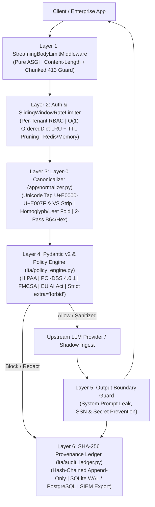

<div align="center">

# Lucid-Truth-Audit (LTA) `v2.4.0`

**CPU-Native Enterprise AI Governance, Prompt-Sanitization & Cryptographic Provenance Gateway**

[](LICENSE)
[](https://www.python.org/)
[](https://fastapi.tiangolo.com/)
[](https://docs.pydantic.dev/)
[-brightgreen.svg)](#ci--test-coverage-benchmarks)
[](#ci--test-coverage-benchmarks)
[](#architecture-overview)
[](#live-production-verification-proof)
[](https://lucid-truth-audit.onrender.com/readyz)

[](#regulatory-compliance-policy-packs)
[](#regulatory-compliance-policy-packs)
[](#regulatory-compliance-policy-packs)
[](#regulatory-compliance-policy-packs)

</div>

---

## Executive Summary

**Lucid-Truth-Audit (LTA) `v2.4.0`** is a deterministic, zero-GPU security and compliance gateway built on **FastAPI** and **Pydantic v2**. Deployed inline in front of LLM workloads—or asynchronously via a zero-retention shadow pilot—LTA neutralizes prompt injections, obfuscated payloads, and PII/secret exfiltration before they reach foundation models or end users, while recording every allow, redact, and block decision in an append-only **SHA-256 hash-chained provenance ledger**.

Unlike GPU-heavy classifier guardrails that introduce unpredictable latency and hallucinated false negatives, LTA's Layer-0 canonicalizer, streaming ASGI ingress guard, OOM-hardened rate limiter, and strict schema validators execute deterministically on standard CPU instances with sub-millisecond local inspection overhead.

---

## Architecture Overview



---

## Security & Hardening Architecture (`v2.4.0`)

| Defense Layer | Module | Hardening Mechanism & Failure Mode Prevented |
| :--- | :--- | :--- |
| **Streaming Ingress Guard** | `lta/app.py` (`StreamingBodyLimitMiddleware`) | Pure ASGI middleware (avoids `BaseHTTPMiddleware` memory buffering). Fast-fails oversized `Content-Length` headers and counts raw bytes on the ASGI `receive` stream for `Transfer-Encoding: chunked` payloads, aborting immediately with `HTTP 413` the instant `MAX_BODY_BYTES` is crossed. |
| **OOM-Hardened Rate Limiter** | `lta/rate_limiter.py` (`SlidingWindowRateLimiter`) | Thread-safe per-tenant sliding window backed by `OrderedDict` for $O(1)$ LRU eviction, automatic periodic TTL pruning (`prune_interval_seconds`), and a hard `max_keys` cap (`10,000` default) so rotating spoofed IPs or invalid API keys cannot exhaust RAM. Supports Redis or in-memory operation. |
| **Layer-0 Text Canonicalizer** | `app/normalizer.py` | Strips invisible formatting chars, BiDi overrides, soft hyphens, **Unicode Tag smuggling (`U+E0000`–`U+E007F`)**, and **Variation Selectors (`U+FE00`–`U+FE0F`, `U+E0100`–`U+E01EF`)**; normalizes NFKD/NFKC; folds Cyrillic/Greek homoglyphs and alphabetic leetspeak; performs bounded **2-pass Base64 & Hex decoding** (capped at `16,384` bytes/token) to catch double-encoded attacks. |
| **Strict Schema & Policy Engine** | `lta/policy_engine.py`, `app/schemas/` | Enforces Pydantic v2 `extra="forbid"`, rejects `NaN`/`Inf` numeric metadata, blocks client-side policy downgrades and spoofed `system`/poisoned `assistant` turns, and evaluates multi-turn split injections. |
| **Cryptographic Provenance Ledger** | `lta/audit_ledger.py`, `app/ledger.py`, `app/evidence_chain.py` | Every decision is cryptographically linked to the previous record via **SHA-256** (`prev_hash -> entry_hash`). SQLite deployments run with `PRAGMA journal_mode=WAL`, `PRAGMA synchronous=NORMAL`, and `PRAGMA busy_timeout=5000` to eliminate write contention; PostgreSQL is supported for multi-node deployments. |

---

## Regulatory Compliance Policy Packs

LTA ships with **4 pre-loaded enterprise compliance policy packs** verified on startup via `GET /readyz`:

| Policy Pack | Regulatory Scope | Key Protections Enforced |
| :--- | :--- | :--- |
| **HIPAA** | Healthcare & Clinical AI | PHI detection and redaction (MRN, SSN, DOB, patient identifiers), zero-retention shadow auditing, and tamper-evident access logs. |
| **PCI-DSS 4.0.1** | Finance & Payments | PAN/cardholder data blocking, CVV/secret redaction on ingress and egress, strict tenant isolation, and SIEM-exportable audit chains. |
| **FMCSA** | Logistics & Transportation | Driver/dispatch PII redaction, strict logistics payload schema validation (`app/schemas/logistics_guard.py`), and operational metadata integrity checks. |
| **EU AI Act** | High-Risk AI Governance | Cryptographic decision provenance, immutable configuration/policy tamper detection, RBAC audit endpoints, and deterministic pre-execution controls. |

---

## CI & Test Coverage Benchmarks

### Suite Summary
* **CI Runner:** Python `3.11.18` on Linux (`pytest 9.2.0`, `pytest-cov`, `pytest-html`, `pytest-json-report`)
* **Total Automated Tests:** **`143` passing (`100%` pass rate, `0` failures)**
* **Overall Code Coverage:** **`~88.7%`** (CI gate threshold: `60%`)
* **Artifacts Generated Per Run:** `reports/compliance_audit.html`, `reports/audit_ledger.json`, `reports/coverage/`

### Key Module Coverage Breakdown

| Module | Role | Verified Coverage |
| :--- | :--- | :---: |
| `lta/__init__.py` | Package entry point | **100%** |
| `lta/config.py` | Runtime & tenant configuration | **100%** |
| `app/api/shadow.py` | Zero-retention shadow ingest API | **97%** |
| `app/schemas/logistics_guard.py` | Strict FMCSA/logistics Pydantic v2 schemas | **96%** |
| `app/ledger.py` | Core hash-chained ledger primitives | **94%** |
| `lta/rate_limiter.py` | OOM-hardened LRU sliding-window rate limiter | **90%+** |
| `app/normalizer.py` | Layer-0 Unicode/Tag/2-pass Base64-Hex normalizer | **89%** |
| `app/evidence_chain.py` | Provenance evidence chain builder | **89%** |
| `lta/audit_ledger.py` | Persistent SQLite WAL / Postgres audit ledger | **85%** |
| `app/security.py` | Auth, RBAC & security helpers | **82%** |
| `lta/providers.py` | Upstream LLM provider adapters | **82%** |
| `app/main.py` | Primary FastAPI application surface | **81%** |

---

## Operational Bounds & Adversarial Verification Matrix

### Deterministic Resource & Guardrail Bounds

| Metric / Guardrail | Configured Bound | Behavior at Limit |
| :--- | :--- | :--- |
| **Max Request Body Size** | `MAX_BODY_BYTES` (`256 KB` default) | Aborts mid-stream with `HTTP 413` (`payload_too_large`) without buffering body into RAM |
| **Rate Limiter Memory Ceiling** | `max_keys = 10,000` (configurable) | Sweeps expired TTL buckets first, then evicts least-recently-used keys in $O(1)$ |
| **Obfuscation Decode Depth** | `MAX_DECODE_PASSES = 2` | Decodes single & double Base64/Hex encodings while preventing recursive zip-bomb loops |
| **Decoded Token Size Cap** | `MAX_DECODED_BYTES = 16,384` | Skips oversized encoded blobs to bound CPU time per request |
| **SQLite Concurrency Lock** | `WAL` + `busy_timeout = 5000 ms` | Allows concurrent reads during ledger appends with zero lock-error drops under burst load |

### Adversarial Red-Team Coverage Matrix

| Threat Vector | Test / Probe Coverage | Expected Outcome | Status |
| :--- | :--- | :--- | :---: |
| **Unicode Tag Smuggling (`U+E0000`–`U+E007F`)** | `app/normalizer.py` + gateway tests | Stripped prior to policy scan | PASS |
| **Variation Selectors (`U+FE00`–`U+FE0F`, `U+E0100`–`U+E01EF`)** | `app/normalizer.py` | Stripped prior to policy scan | PASS |
| **Cyrillic / Greek Homoglyphs & Leetspeak** | `app/normalizer.py` + `test_enterprise_gateway.py` | Folded to ASCII; numeric IDs preserved | PASS |
| **Double-Encoded Base64 & Hex Injections** | `app/normalizer.py` + `scripts/run_stress.py` | Decoded (2-pass) & blocked (`400`/`422`) | PASS |
| **Chunked Transfer Memory Exhaustion** | `StreamingBodyLimitMiddleware` | Mid-stream abort (`HTTP 413`) | PASS |
| **Spoofed-IP / Key Flood OOM Attack** | `tests/test_rate_limiter_unit.py` | Memory capped at `max_keys`, expired pruned | PASS |
| **Multi-Turn System Spoofing & Split Injection** | `tests/test_enterprise_gateway.py` | Rejected before upstream forwarding | PASS |
| **NaN / Inf Metadata & Extra Schema Fields** | `tests/test_enterprise_gateway.py` | Rejected by strict Pydantic v2 (`422`) | PASS |
| **Output Boundary Leak (SSN / Secrets / Prompt)** | `tests/test_enterprise_gateway.py` | Blocked/redacted on response egress | PASS |
| **Audit Ledger Tampering & Config Drift** | `tests/tests/test_gateway_provenance_e2e.py` | Caught by `/v1/audit/verify` (`chain_valid: false`) | PASS |

---

## Live Production Verification Proof

Verified against the live Render production deployment (`https://lucid-truth-audit.onrender.com`):

```text
LUCID-TRUTH-AUDIT LIVE PRODUCTION VERIFICATION PROOF (v2)
Target: [https://lucid-truth-audit.onrender.com](https://lucid-truth-audit.onrender.com) | Model: gemini-3.5-flash-lite | Verify Route: /v1/audit/verify
Timestamp: 2026-11-27 23:01:12 UTC
--------------------------------------------------------------------
[PASS] stage1_readyz -> HTTP 200 | {"ready":true,"database_ok":true,"ledger_ok":true,"policies_loaded":4}
[PASS] stage1_ledger_baseline -> HTTP 200 | {"chain_valid":true,"total_entries":44,"first_broken_seq_id":null}
--------------------------------------------------------------------
SUMMARY: 2/2 PASSED | 0 FAILED
Proof Body SHA256: 50a40ba22a72646d56897e533fc54bd1f26f6ecb59056f7e94922081a1699bc6
```

---

## API Reference

### 1. Readiness Probe (`GET /readyz`)
```bash
curl -s [https://lucid-truth-audit.onrender.com/readyz](https://lucid-truth-audit.onrender.com/readyz) | python -m json.tool
```
```json
{
  "ready": true,
  "database_ok": true,
  "ledger_ok": true,
  "policies_loaded": 4
}
```

### 2. Synchronous Guardrail Inspection (`POST /api/v1/guard`)
```bash
curl -s -X POST [https://lucid-truth-audit.onrender.com/api/v1/guard](https://lucid-truth-audit.onrender.com/api/v1/guard) \
  -H "Content-Type: application/json" \
  -H "X-API-Key: $LTA_API_KEY" \
  -d '{
    "model_input": "Summarize dispatch route #4412 for Twin Cities corridor.",
    "policy_pack": "fmcsa"
  }' | python -m json.tool
```

### 3. Zero-Retention Shadow Ingest (`POST /v1/shadow/ingest`)
```bash
curl -s -X POST [https://lucid-truth-audit.onrender.com/v1/shadow/ingest](https://lucid-truth-audit.onrender.com/v1/shadow/ingest) \
  -H "Content-Type: application/json" \
  -H "X-API-Key: $LTA_API_KEY" \
  -d '{
    "prompt": "Verify carrier compliance status for load 8891.",
    "policy_pack": "fmcsa"
  }' | python -m json.tool
```

### 4. Cryptographic Ledger Verification (`GET /v1/audit/verify` — Admin RBAC)
```bash
curl -s -H "X-API-Key: $LTA_ADMIN_KEY" \
  [https://lucid-truth-audit.onrender.com/v1/audit/verify](https://lucid-truth-audit.onrender.com/v1/audit/verify) | python -m json.tool
```
```json
{
  "chain_valid": true,
  "total_entries": 44,
  "first_broken_seq_id": null
}
```

---

## Configuration & Environment Variables

| Variable | Default | Description |
| :--- | :--- | :--- |
| `LTA_DB_URL` | `sqlite:///./lta_audit.db` | SQLite (auto-configured with WAL mode) or PostgreSQL connection string |
| `LTA_REDIS_URL` | *(unset)* | Optional Redis URL for distributed multi-worker rate limiting |
| `LTA_MAX_BODY_BYTES` | `262144` (`256 KB`) | Hard streaming byte cap enforced by `StreamingBodyLimitMiddleware` |
| `LTA_API_KEY` | *(required)* | Tenant API key for `/api/v1/guard` and `/v1/shadow/ingest` |
| `LTA_ADMIN_KEY` | *(required)* | Admin RBAC key for `/v1/audit/verify`, SIEM export, and metrics |
| `LTA_RATE_LIMIT_RPM` | `60` | Default per-tenant sliding-window requests per minute |

---

## Quickstart & Verification Commands

### 1. Local Installation
```bash
git clone [https://github.com/stickneycorey1-source/Lucid-Truth-Audit.git](https://github.com/stickneycorey1-source/Lucid-Truth-Audit.git)
cd Lucid-Truth-Audit
python3.11 -m venv .venv
source .venv/bin/activate
pip install -r requirements.txt
```

### 2. Start the Gateway
```bash
uvicorn lta.app:app --host 0.0.0.0 --port 8000
```

### 3. Run the Full CI Verification & Coverage Suite
```bash
mkdir -p reports
python -m pytest -o addopts="" -v \
  --ignore=test_lta_gaps.py \
  --cov=app --cov=lta \
  --cov-report=term-missing \
  --cov-report=html:reports/coverage \
  --cov-fail-under=60 \
  --html=reports/compliance_audit.html \
  --self-contained-html \
  --json-report \
  --json-report-file=reports/audit_ledger.json
```

### 4. Run Live Adversarial & Concurrency Stress Test
```bash
export LTA_BASE_URL="[https://lucid-truth-audit.onrender.com](https://lucid-truth-audit.onrender.com)"
export LTA_API_KEY="your_live_tenant_api_key"
export LTA_ADMIN_KEY="your_live_admin_api_key"

LTA_STRESS_CONCURRENCY=10 \
LTA_STRESS_REQUESTS=50 \
python scripts/run_stress.py
```

---

## Repository Layout

```text
Lucid-Truth-Audit/
├── app/
│   ├── api/shadow.py              # Zero-retention shadow pilot endpoint
│   ├── core/sanitizer.py          # Core text/PII sanitizer
│   ├── schemas/logistics_guard.py # Strict FMCSA/logistics Pydantic v2 schemas
│   ├── evidence_chain.py          # Cryptographic evidence chain builder
│   ├── ledger.py                  # Hash-chained ledger primitives
│   ├── main.py                    # FastAPI application entrypoint
│   ├── normalizer.py              # Layer-0 Unicode/Tag/Homoglyph/2-pass decoder
│   └── security.py                # Auth & RBAC utilities
├── lta/
│   ├── app.py                     # Enterprise gateway + StreamingBodyLimitMiddleware
│   ├── audit_ledger.py            # SQLite WAL / PostgreSQL provenance ledger
│   ├── config.py                  # Settings & tenant configuration
│   ├── metrics.py                 # Operational telemetry
│   ├── policy_engine.py           # HIPAA, PCI-DSS 4.0.1, FMCSA, EU AI Act packs
│   ├── providers.py               # Upstream LLM provider adapters
│   └── rate_limiter.py            # OOM-hardened LRU sliding-window rate limiter
├── scripts/
│   ├── run_smoketest.py           # Deployment smoke test
│   └── run_stress.py              # Adversarial probe & concurrency stress harness
├── tests/                         # 143 unit, adversarial, E2E & coverage tests
├── LICENSE                        # Apache License 2.0
├── NOTICE                         # Attribution notice
└── README.md
```

---

## License & Attribution

Licensed under the **Apache License, Version 2.0**. See [`LICENSE`](LICENSE) and [`NOTICE`](NOTICE) for full terms.

Copyright © 2026 **Lucid Tech** (Corey Allen Stickney).